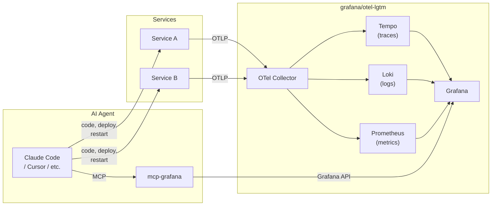
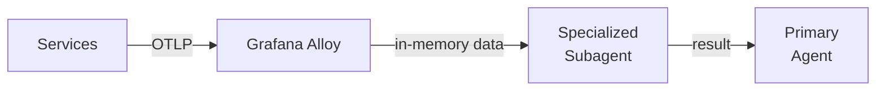

import { Callout } from 'nextra/components'

## The gap

AI agents write code, run tests, and navigate entire codebases. When something fails at runtime the development workflow breaks down. The developer context-switches to new prompts, adds debug logs, runs targeted tests, correlates outputs, and feeds findings back to the agent. The agent, in turn, burns extra tokens asking follow-up questions that pollute the context window with noise. Either way, someone loses time.

The question isn't whether to give agents runtime visibility, but how to do it without making the token cost prohibitive.

## AI agents can debug their own code

Two approaches exist for giving an agent access to telemetry. They differ dramatically in token efficiency and signal quality.

| Approach | How it works | Pros | Cons |
|----------|--------------|------|------|
| Raw telemetry | Agent tails `docker logs`, curls metric endpoints, parses output directly | No extra infrastructure | A single log dump can be thousands of lines; scales poorly |
| Structured aggregation | Agent asks "give me errors from the last minute" and receives a concise, structured response | Token-efficient; returns exactly what the agent needs | Requires an aggregation layer |

The aggregation layer already exists — it's Grafana.

[Grafana Labs](https://grafana.com) maintains [`mcp-grafana`](https://github.com/grafana/mcp-grafana), an [MCP (Model Context Protocol)](https://modelcontextprotocol.io/) server that exposes 60+ tools over Grafana datasources: PromQL queries, LogQL queries, TraceQL queries, dashboard search, alerts, and incidents.

Combined with [`grafana/otel-lgtm`](https://github.com/grafana/docker-otel-lgtm) — a Docker image that packages Grafana, Prometheus, Loki, Tempo, and an OTel Collector — you get a complete observability stack ready to connect to any AI agent via MCP.

## Architecture

Services emit telemetry over OTLP. The Collector distributes it to the appropriate backends. Grafana aggregates and exposes it. The agent queries it via MCP — and also interacts directly with services to write code, deploy, or restart. **Two channels: one to act, one to observe.**



## Wiring the stack

Connecting the pieces requires two configurations: a Docker Compose service for the LGTM stack, and an MCP client entry pointing the agent at Grafana.

```yaml
# docker-compose.yml
services:
  otel-lgtm:
    image: grafana/otel-lgtm:0.20.0
    ports:
      - "3000:3000"   # Grafana UI
      - "4317:4317"   # OTLP gRPC
      - "4318:4318"   # OTLP HTTP
```

```json
// .mcp.json
{
  "mcpServers": {
    "grafana": {
      "command": "docker",
      "args": [
        "run", "-i", "--rm",
        "-e", "GRAFANA_URL=http://host.docker.internal:3000",
        "-e", "GRAFANA_SERVICE_ACCOUNT_TOKEN=<your-token>",
        "mcp/grafana", "-t", "stdio"
      ]
    }
  }
}
```

Or, if you're using Claude Code, one command:

```bash
claude mcp add grafana -- docker run -i --rm \
  -e GRAFANA_URL=http://host.docker.internal:3000 \
  -e GRAFANA_SERVICE_ACCOUNT_TOKEN=<your-token> \
  mcp/grafana -t stdio
```

<Callout type="info">
**What makes telemetry AI-friendly?** The stack alone isn't enough — the agent is only as good as the signals it queries.

- **Structured logs (JSON, not free text)** — `{"level":"error","msg":"connection timeout","service":"api","trace_id":"abc123","latency_ms":5023}` lets the agent filter by field. A line like `ERROR: something went wrong` doesn't.
- **Semantic span names** — `order.validate` or `db.query.findUser` tells the agent what the operation does. `handler` or `span-1` doesn't.
- **Trace context propagation** — When every service forwards `traceparent`, the agent can follow a single request across service boundaries with one LogQL query.
- **Descriptive metric names** — `db_connection_pool_active` is self-explanatory for the agent. `pool_n` requires guessing.
</Callout>

## Limitations / tradeoffs

The approach works, but several rough edges are worth naming before adopting it.

**`grafana/otel-lgtm` is a development image.** It packages Loki, Tempo, Prometheus, and Grafana into a single container for convenience. Grafana Labs explicitly marks it as not production-ready. Use it for local development and demos; run separate, purpose-built containers in production.

**The agent lacks domain context.** Telemetry is data, not understanding. A log message mentioning a timeout may point at the wrong service. A latency spike in a trace may reflect normal behavior under load. Without context about how services interact and what constitutes abnormal behavior, the agent can draw confident but wrong conclusions from any signal type.

**MCP adds a round-trip per query.** Every tool call goes agent → mcp-grafana → Grafana API → mcp-grafana → agent. For interactive debugging this is acceptable; for high-frequency diagnostic loops it adds up.

**60+ tools is a large surface area.** `mcp-grafana` exposes a wide range of capabilities, which means the agent needs guidance on which tools are relevant to the current task. Without a system prompt or task framing that scopes the toolset, the agent may explore inefficiently.

<Callout type="warning">
Don't expose `mcp-grafana` with admin credentials in shared environments. The MCP server inherits whatever permissions the Grafana service account has — including the ability to modify dashboards and silence alerts.
</Callout>

## What's next

<Callout type="info">
A companion demo repository is under development — a multi-service Docker Compose stack instrumented with OpenTelemetry, a Grafana LGTM container, mcp-grafana, and a reproducible AI-assisted debugging scenario.
</Callout>

[Grafana Alloy](https://grafana.com/oss/alloy/) opens an interesting direction: a telemetry pipeline that processes data in memory without storing it. Alloy can receive OTLP, apply transformations, and surface data directly — without Prometheus, Loki, or Tempo as backends.



Two use cases become practical with this model:

- **CI/CD pipelines**: a specialized subagent spins up Alloy during test execution, collects telemetry in memory, and diagnoses failures without a persistent observability stack
- **Ephemeral investigation**: a lightweight telemetry pipeline for a specific incident, with no storage overhead and no cleanup required after

This is currently speculative — Alloy's pipeline configuration for this pattern is not yet validated, and the subagent interaction model is untested. It's a direction worth exploring once the core Grafana + MCP integration is stable.

## Further reading

These links informed the design and surface useful context for taking this further.

- [Going beyond AI chat response: How we're building an agentic system to drive Grafana](https://grafana.com/blog/2025/06/30/going-beyond-ai-chat-response-how-were-building-an-agentic-system-to-drive-grafana/) — Multi-agent architecture, MCP integration, and token noise reduction inside Grafana
- [LLM-powered insights into your tracing data: introducing MCP support in Grafana Cloud Traces](https://grafana.com/blog/llm-powered-insights-into-your-tracing-data-introducing-mcp-support-in-grafana-cloud-traces/) — MCP integration in Grafana Cloud for trace analysis
- [A tale of two incident responses: how our AI assist helped us find the cause 3.5x faster](https://grafana.com/blog/a-tale-of-two-incident-responses-how-our-ai-assist-helped-us-find-the-cause-3-5x-faster/) — Real-world comparison: AI agents diagnosed an incident in 8 min vs 28 min for humans
- [AI Observability Tool/MCP Servers Has No Real Model of Your System](https://news.ycombinator.com/item?id=44647275) — Critical perspective on MCP limitations in observability
- [Your AI Assistant Just Became Your Best Debugging Partner: Using Grafana LGTM with Claude Code](https://medium.com/@CalumBoal/your-ai-assistant-just-became-your-best-debugging-partner-using-grafana-lgtm-with-claude-code-ed2f5c05fd36) — Practical walkthrough of the same stack: Grafana LGTM + mcp-grafana + Claude Code
