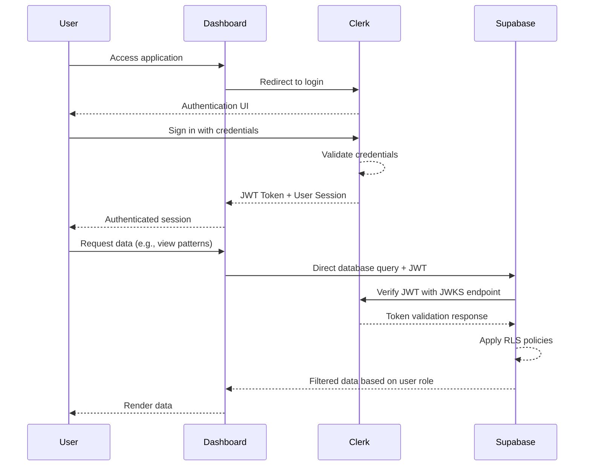
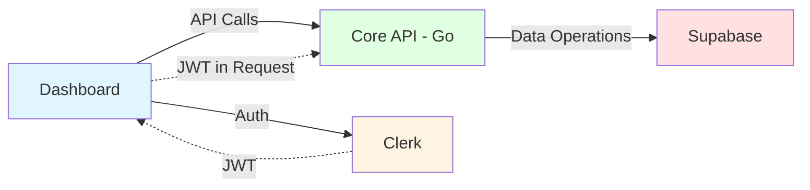
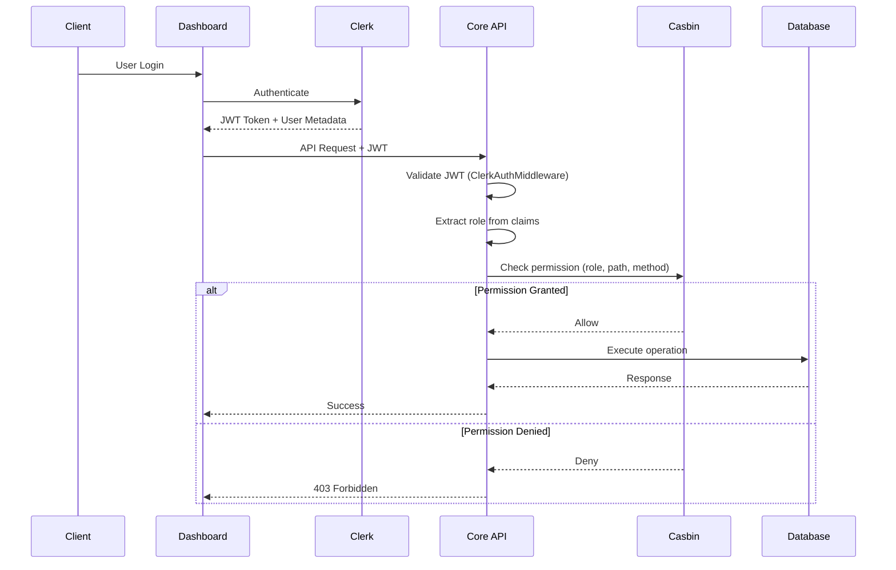
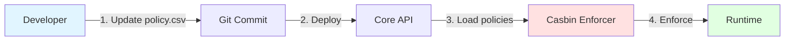

import { Callout } from 'nextra/components'
import { Steps } from 'nextra/components'

When you build a backend service, you need to handle both authentication (who is the user?) and authorization (what can they do?). This post shows how I implemented Role-Based Access Control using **Clerk** for authentication and **Casbin** for authorization in the app.

## The Context: Architectural Evolution

### Initial Architecture

The first version was straightforward:

- The **Next.js dashboard** talked directly to [**Supabase**](https://supabase.com/) for reads and writes
- **[Clerk](https://clerk.com/)** handled authentication
- [**Supabase RLS**](https://supabase.com/docs/guides/database/postgres/row-level-security) (Row Level Security) handled authorization, integrated with Clerk

This worked great for getting started:



- Simple to understand
- Few moving parts
- Easy to develop


### The Problem

As requirements grew, the direct database approach started showing its limits:

1. **Latency**: Trading operations need to be fast (sub-100ms), and database round-trips add up
2. **Business Logic**: Pattern recognition and validation logic fits better in application code than in database functions
3. **No CDC Dependency**: I wanted to avoid relying on Change Data Capture for real-time updates
4. **Write Scalability**: Direct database connections don't scale great for write-heavy workloads
5. **Testing**: Testing business logic in database functions is painful

### The Solution

I added a backend service (Core API) to handle:

- Complex business logic in Go (fast and type-safe)
- Optimized endpoints for time-sensitive operations
- An abstraction layer over Supabase
- Better caching and request optimization
- Easier integration testing



**The new challenge**: I needed to replicate the authorization that Supabase RLS was providing, but now in the backend. Just validating Clerk JWTs wasn't enough—I needed role-based access control.

## The Challenge

With the backend service in place, I needed to:

1. **Validate JWTs** from Clerk
2. **Enforce role-based permissions** on API endpoints
3. **Separate concerns**: Authentication logic should be independent from authorization policies
4. **Make it testable**: The security layer needs good test coverage
5. **Keep it flexible**: Add new permissions without redeploying

I wanted to:

- Define authorization policies declaratively (like RLS, but in code)
- Update permissions without touching the main codebase
- Support multiple roles with different access levels
- Integrate cleanly with Echo (the HTTP framework)

## Architecture Overview

The solution uses two tools:

- **[Clerk](https://clerk.com/)**: Handles authentication, user management, and JWT tokens
- **[Casbin](https://casbin.org/)**: Authorization library supporting RBAC, ABAC, and ACL models



## Implementation

<Steps>

### Step 1: Configure Clerk Authentication

First, I created a middleware to validate JWT tokens from Clerk. It extracts user roles from the token claims and passes them along to other handlers.

```go
// apps/core/internal/interfaces/http/middleware/clerk_auth.go
package middleware

import (
    "github.com/golang-jwt/jwt/v5"
    "github.com/labstack/echo/v4"
    echojwt "github.com/labstack/echo-jwt/v4"
)

type CustomClaims struct {
    jwt.RegisteredClaims
    Metadata struct {
        Role string `json:"role"`
    } `json:"metadata"`
}

func NewClerkAuthMiddleware(jwksURL string) echo.MiddlewareFunc {
    config := echojwt.Config{
        KeyFunc: func(token *jwt.Token) (interface{}, error) {
            // Fetch and validate keys from Clerk's JWKS endpoint
            return jwks.GetKey(token, jwksURL)
        },
        NewClaimsFunc: func(c echo.Context) jwt.Claims {
            return new(CustomClaims)
        },
        SuccessHandler: func(c echo.Context) {
            // Extract role from JWT claims and store in context
            token := c.Get("user").(*jwt.Token)
            claims := token.Claims.(*CustomClaims)
            role := claims.Metadata.Role
            
            if role == "" {
                role = "viewer" // Default role
            }
            
            c.Set("user_role", role)
        },
    }
    
    return echojwt.WithConfig(config)
}
```

**Key decisions:**

1. **JWKS Validation**: Validate tokens against Clerk's JWKS endpoint
2. **Role Extraction**: Get user roles from the JWT metadata field (Clerk's custom claims)
3. **Default Role**: No role? Default to "viewer" with minimal permissions
4. **Context Storage**: Store the role in Echo's context for later use

### Step 2: Define Casbin Authorization Model

Casbin uses a declarative model to define authorization logic. Here's the RBAC model:

```conf
# apps/core/internal/config/auth/model.conf
[request_definition]
r = sub, obj, act

[policy_definition]
p = sub, obj, act

[policy_effect]
e = some(where (p.eft == allow))

[matchers]
m = r.sub == p.sub && keyMatch(r.obj, p.obj) && r.act == p.act
```

**What each part means:**

- **Request**: `(subject, object, action)` → e.g., `(admin, /api/v1/pattern, POST)`
- **Policy**: Permission rules (stored as CSV)
- **Effect**: How to combine policies (some allow = at least one must allow)
- **Matcher**: How to match requests to policies (`keyMatch` handles path patterns)

### Step 3: Define Authorization Policies

Policies live in a CSV file (no code changes needed to update them):

```csv
# apps/core/internal/config/auth/policy.csv
p, admin, /api/v1/pattern, POST
p, maker, /api/v1/pattern, POST
p, viewer, /api/v1/pattern, GET
```

**Role Definitions:**

- **admin**: Full access to create patterns
- **maker**: Can create new trading patterns
- **viewer**: Read-only access to view patterns

<Callout type="info">
  You can also store policies in a database for dynamic updates. I use CSV for now since it's version-controlled and environment-specific.
</Callout>

### Step 4: Implement Casbin Middleware

The Casbin middleware checks if the user's role has permission for the requested action:

```go
// apps/core/internal/interfaces/http/middleware/casbin_auth.go
package middleware

import (
    "net/http"
    "github.com/casbin/casbin/v2"
    "github.com/labstack/echo/v4"
)

func NewCasbinMiddleware(enforcer *casbin.Enforcer) echo.MiddlewareFunc {
    return func(next echo.HandlerFunc) echo.HandlerFunc {
        return func(c echo.Context) error {
            // 1. Get role from context (set by Clerk middleware)
            role, ok := c.Get("user_role").(string)
            if !ok {
                return echo.NewHTTPError(http.StatusUnauthorized, "role not found")
            }

            // 2. Get path and method
            obj := c.Path()           // e.g., /api/v1/pattern
            act := c.Request().Method // e.g., POST

            // 3. Check permission with Casbin
            allowed, err := enforcer.Enforce(role, obj, act)
            if err != nil {
                return echo.NewHTTPError(http.StatusInternalServerError, "authorization check failed")
            }

            if !allowed {
                return echo.NewHTTPError(http.StatusForbidden, "insufficient permissions")
            }

            return next(c)
        }
    }
}
```

**Authorization Flow:**

1. Extract user role from Echo context (populated by Clerk middleware)
2. Get the requested resource (path) and action (HTTP method)
3. Query Casbin enforcer to check if `(role, path, method)` is allowed
4. Return 403 Forbidden if permission is denied
5. Proceed to handler if permission is granted

### Step 5: Configure Server Middleware Stack

Middleware order matters a lot:

```go
// apps/core/internal/interfaces/http/server.go
func NewServer(cfg *config.Config, logger *slog.Logger, runner HealthChecker) *Server {
    e := echo.New()
    
    // 1. Request ID generation (for tracing)
    e.Use(echomiddleware.RequestID())
    
    // 2. CORS configuration
    e.Use(echomiddleware.CORSWithConfig(echomiddleware.CORSConfig{
        AllowOrigins: []string{"*"}, // Configure per environment
    }))
    
    // 3. Initialize Casbin enforcer
    enforcer, err := casbin.NewEnforcer(
        cfg.Auth.ModelPath,
        cfg.Auth.PolicyPath,
    )
    if err != nil {
        logger.Error("Failed to create Casbin enforcer", "error", err)
        panic(err)
    }
    
    // 4. Clerk authentication (validates JWT, extracts role)
    e.Use(custommiddleware.NewClerkAuthMiddleware(cfg.Auth.ClerkJWKSURL))
    
    // 5. Casbin authorization (enforces RBAC)
    e.Use(custommiddleware.NewCasbinMiddleware(enforcer))
    
    // 6. Request logging (after auth for user context)
    e.Use(custommiddleware.RequestLogger(logger))
    
    // 7. Custom error handler
    e.HTTPErrorHandler = custommiddleware.ErrorHandler(logger)
    
    return &Server{
        echo:   e,
        logger: logger,
        runner: runner,
    }
}
```

**Why this order:**

1. **RequestID**: Generate IDs early for tracing
2. **CORS**: Handle preflight before auth
3. **Clerk Auth**: Validate JWT and extract user
4. **Casbin Auth**: Check permissions
5. **Request Logger**: Log with user context
6. **Error Handler**: Format errors consistently

<Callout type="warning">
  RequestLogger goes after auth so it can include user context in logs.
</Callout>

### Step 6: Update API Routes

I restructured routes to add versioning:

```diff
- /patterns → /api/v1/pattern
```

Benefits:
- API versioning for backward compatibility
- Singular resource names
- Clear namespace for future versions

### Step 7: Dashboard Integration

Created an authenticated API client for the Next.js dashboard:

```typescript
// apps/dashboard/src/lib/coreApi.ts
import { useAuth } from "@clerk/nextjs";

export type GetTokenFn = () => Promise<string | null>;

export function createAuthenticatedFetch(getToken: GetTokenFn) {
  return async (path: string, options: RequestInit = {}): Promise<Response> => {
    const token = await getToken();
    
    if (!token) {
      throw new Error("No authentication token available");
    }

    const baseUrl = getCoreApiBaseUrl();
    const url = `${baseUrl}${path}`;

    const headers = new Headers(options.headers);
    headers.set("Authorization", `Bearer ${token}`);
    
    if (options.body && !headers.has("Content-Type")) {
      headers.set("Content-Type", "application/json");
    }

    return fetch(url, { ...options, headers });
  };
}

// Usage in React components
export function useCoreApi() {
  const { getToken } = useAuth();
  return createAuthenticatedFetch(getToken);
}
```

**Benefits:**

- Type-safe API calls with TypeScript
- Clerk SDK handles token refresh automatically
- Configure base URL via environment variables
- Centralized error handling

</Steps>

## Testing

I added tests to make sure the security layer works as expected:

### Unit Tests

```go
// apps/core/internal/interfaces/http/middleware/casbin_auth_test.go
func TestCasbinMiddleware(t *testing.T) {
    tests := []struct {
        name           string
        role           string
        path           string
        method         string
        expectedStatus int
    }{
        {"Admin allow POST", "admin", "/api/v1/pattern", "POST", http.StatusOK},
        {"Maker allow POST", "maker", "/api/v1/pattern", "POST", http.StatusOK},
        {"Viewer deny POST", "viewer", "/api/v1/pattern", "POST", http.StatusForbidden},
        {"Viewer allow GET", "viewer", "/api/v1/pattern", "GET", http.StatusOK},
        {"Anonymous deny", "anonymous", "/api/v1/pattern", "POST", http.StatusForbidden},
    }

    for _, tt := range tests {
        t.Run(tt.name, func(t *testing.T) {
            // Test implementation...
        })
    }
}
```

### Integration Tests

End-to-end tests for the complete auth flow:

```go
// apps/core/internal/interfaces/http/handlers/pattern_handler_integration_test.go
func TestCreatePattern_AuthenticationAndAuthorization_Integration(t *testing.T) {
    // Setup test environment with real Casbin enforcer
    enforcer, err := casbin.NewEnforcer(modelPath, policyPath)
    require.NoError(t, err)

    // Setup Echo with middleware stack
    e := echo.New()
    e.Use(middleware.NewClerkAuthMiddlewareWithKeyFunc(testKeyFunc))
    e.Use(middleware.NewCasbinMiddleware(enforcer))
    e.POST("/api/v1/pattern", handler.HandlePostPattern)

    // Test different roles and scenarios
    testCases := []struct {
        role           string
        expectedStatus int
    }{
        {"admin", http.StatusCreated},
        {"maker", http.StatusCreated},
        {"viewer", http.StatusForbidden},
    }
    
    for _, tc := range testCases {
        // Generate test JWT with role
        // Make request
        // Assert response
    }
}
```

## What I Got From This

A few things that make this setup nice:

### Security

- Multiple layers: authentication → authorization → business logic
- Users only access what they need
- Authorization decisions are logged

### Maintainability

- Authorization rules live in CSV, not scattered in code
- Each middleware does one thing
- Easy to test each piece independently

### Flexibility

- Casbin caches decisions for speed
- Add complex policies without changing code
- Easy to add new roles or resources

### Developer Experience



Adding permissions is just adding a line to the CSV:

```csv
p, analyst, /api/v1/analytics, GET
```

No code changes needed.

## Key Takeaways

1. **Separate concerns**: Clerk for identity, Casbin for permissions
2. **Middleware order matters**: Auth before authorization
3. **Test both layers**: Unit tests and integration tests
4. **Declarative policies**: Keep authorization rules out of code
5. **Log with context**: Include user info in logs

## Additional Resources

- [Clerk Documentation](https://clerk.com/docs) - Authentication setup and JWT configuration
- [Casbin Documentation](https://casbin.org/docs/overview) - Authorization models and patterns
- [Echo Framework](https://echo.labstack.com/) - Middleware implementation guide
- [OWASP API Security Top 10](https://owasp.org/www-project-api-security/) - API security best practices
- [NIST RBAC Model](https://csrc.nist.gov/projects/role-based-access-control) - RBAC fundamentals

## What's Next?

Some things I might add later:

- **Dynamic policies**: Move policies to database for runtime updates
- **ABAC**: Add context-aware permissions (time, location, ownership)
- **Rate limiting**: Per-role rate limits
- **Better session management**: Token refresh and revocation
- **Audit logging**: Track all authorization decisions

The combination of Clerk and Casbin works well for this use case—it's flexible, testable, and doesn't get in the way.

